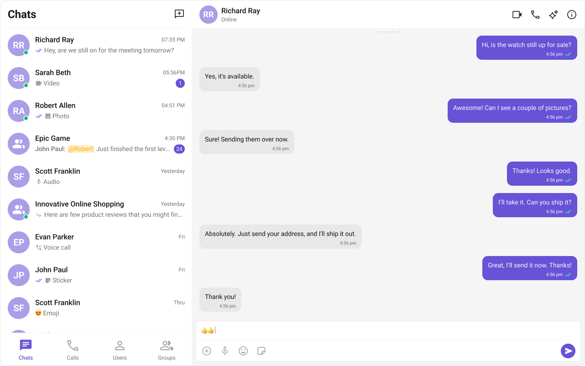

<p align="center">
  
</p>

# CometChat UI Kit for Angular

The CometChat Angular UI Kit provides a pre-built user interface kit that developers can use to quickly integrate a reliable & fully-featured chat experience into an existing or a new Angular app.

<div style="display: flex; align-items: center; justify-content: center;">
   
</div>

## Prerequisites

- Node.js >= 20.19
- npm >= 10
- Angular >= 18 (up to Angular 21)
- Sign up for a [CometChat](https://app.cometchat.com/) account to get your app credentials: _`App ID`_, _`Region`_, and _`Auth Key`_

## Repository Structure

This is a monorepo containing the UI Kit library, a sample application, a Storybook playground, and a documentation site.

```
├── projects/
│   ├── cometchat-uikit/     # UI Kit library (@cometchat/chat-uikit-angular)
│   └── sample-app/          # Sample Angular app demonstrating the UI Kit
├── .storybook/              # Storybook configuration & stories
└── docs/                    # Documentation site (Mintlify)
```

## Getting Started

1. Clone the repository:
   ```sh
   git clone https://github.com/cometchat/cometchat-uikit-angular.git
   ```

2. Checkout the v5 branch:
   ```sh
   git checkout v5
   ```

3. Install dependencies:
   ```sh
   npm install
   ```

4. Enter your CometChat _`App ID`_, _`Region`_, and _`Auth Key`_ in `projects/sample-app/src/main.ts`.

5. Run the sample app:
   ```sh
   npm start
   ```

## UI Kit Library

The core library lives in `projects/cometchat-uikit/` and is published as [`@cometchat/chat-uikit-angular`](https://www.npmjs.com/package/@cometchat/chat-uikit-angular).

**Build the library:**

```sh
npm run build:lib
```

Refer to the [Integration Steps](https://www.cometchat.com/docs/ui-kit/angular/integration) to integrate the UI Kit into your own Angular app.

## Sample App

The sample app in `projects/sample-app/` showcases the full capabilities of the UI Kit — real-time messaging, voice & video calling, conversations, users, groups, and more.

**Run the sample app:**

```sh
npm start
```

## Storybook

Storybook provides an interactive playground to explore and test individual UI Kit components in isolation.

**Run Storybook locally:**

```sh
npm run storybook
```

**Build a static Storybook site:**

```sh
npm run build-storybook
```

## Documentation

The `docs/` directory contains the full documentation site built with [Mintlify](https://mintlify.com), covering component APIs, customization guides, theming, localization, and more.

**Run the docs site locally:**

```sh
cd docs
npm install
npm run dev
```

## Help and Support

For issues running the project or integrating with our UI Kits, consult our [documentation](https://www.cometchat.com/docs/ui-kit/angular/integration) or create a [support ticket](https://help.cometchat.com/hc/en-us) or seek real-time support via the [CometChat Dashboard](https://app.cometchat.com/).

---

## Testing

The project has three test suites: **unit tests** (Vitest), **E2E tests** (Playwright), and **Storybook interaction tests**.

### Check locally before you push

Every CI run costs GitHub Actions minutes, so changes are proven on your machine first and a push is a change that is ready to be judged.

| Command | When | What it runs |
|---|---|---|
| `npm run verify` | Before every push (the pre-push hook runs it for you) | Lockfile, versions, lint, type check, the unit tests related to what you changed, library build. About 1–2 min. |
| `npm run verify:full` | Before marking a PR ready for review | The full unit suite with the coverage floors, the sample-app build and the smoke E2E. Needs the `E2E_*` keys in `.env`; `--no-e2e` skips the E2E part. |

`npm install` installs the git hooks (pre-commit safety checks and the pre-push `verify`) unless you already have your own hooks; `npm run hooks:install` installs them by hand. Skip a hook once, in an emergency only, with `--no-verify`. Both commands compare against the branch yours came from (the closest of `origin/dev-v5` and `origin/master-v5`); pass `--base <ref>` (or set `VERIFY_BASE`) to choose another.

### Unit Tests (Vitest)

Unit tests live alongside the source files as `*.spec.ts` files and cover individual components, services, and utilities.

**Run all unit tests (single pass):**

```sh
npm test
```

**Run in watch mode (re-runs on file changes):**

```sh
npm run test:watch
```

Unit tests use [Vitest](https://vitest.dev/) with Angular's `TestBed` for component testing. No browser or running server is required.

---

### E2E Tests (Playwright)

End-to-end tests live in the `e2e/` directory and run against the live sample app. They cover full user journeys: login, messaging, reactions, threads, groups, search, and more.

#### Prerequisites

E2E credentials go in a **`.env`** file at the repo root, which git ignores. Never put real keys in `projects/sample-app/src/environments/environment.ts`: that file is committed and keeps placeholders, and the pre-commit hook blocks a commit that stages real keys in it.

```sh
cp e2e/.env.example .env
# Then fill in E2E_APP_ID, E2E_REGION, E2E_AUTH_KEY and E2E_API_KEY (the REST API key, used to
# create and delete test data), plus the optional values listed in the file.
```

`npm run verify:full` writes these into the sample app for its E2E build and puts the placeholder file back afterwards. CI reads the same `E2E_*` values from the repository's secrets and variables.

#### Test Data Lifecycle

Every run tags the data it creates with its own run ID, so several runs can share the E2E app. Before a run, the setup:
1. **Deletes** anything this run left behind earlier
2. **Makes sure the 30 shared filler users exist** (`e2e-user-01` through `e2e-user-30`, tagged `e2e-fixture`). They are created once and never deleted, because the app's plan allows only 100 users.
3. **Creates this run's 3 groups** (public, private and password, named after the run)
4. **Seeds 50+ messages** between the primary and secondary test users

After the run, the groups and users **this run** created are **permanently deleted**. The shared filler users and the permanent sample users (`cometchat-uid-1` through `cometchat-uid-5`) are never deleted.

#### Running E2E Tests

**Run all E2E tests (headless):**

```sh
npm run e2e
```

**Run with Playwright UI (interactive, recommended for debugging):**

```sh
npm run e2e:ui
```

**Run in headed mode (visible browser):**

```sh
npm run e2e:headed
```

**Run in debug mode (step through tests):**

```sh
npm run e2e:debug
```

**Run a specific test file:**

```sh
npx playwright test e2e/full-journey.spec.ts
```

**Run a specific test by name:**

```sh
npx playwright test --grep "Send a text message"
```

> The sample app must be running (or Playwright will start it automatically via `webServer` in `playwright.config.ts`).

---

### Storybook Tests

Storybook interaction tests verify that individual components render and behave correctly in isolation.

**Start Storybook (required before running tests):**

```sh
npm run storybook
```

**Run Storybook interaction tests (in a separate terminal):**

```sh
npm run test-storybook
```

Storybook stories live in `*.stories.ts` files alongside each component. They serve as both a visual playground and a test harness.

---

### Test Summary

| Suite | Command | What it tests |
|---|---|---|
| Local verify | `npm run verify` / `npm run verify:full` | The PR gate's checks, on your machine |
| Unit (Vitest) | `npm test` | Components, services, utilities |
| Unit (watch) | `npm run test:watch` | Same, re-runs on change |
| E2E (Playwright) | `npm run e2e` | Full user journeys in browser |
| E2E (UI mode) | `npm run e2e:ui` | Same, with interactive Playwright UI |
| Storybook | `npm run test-storybook` | Component stories in isolation |
